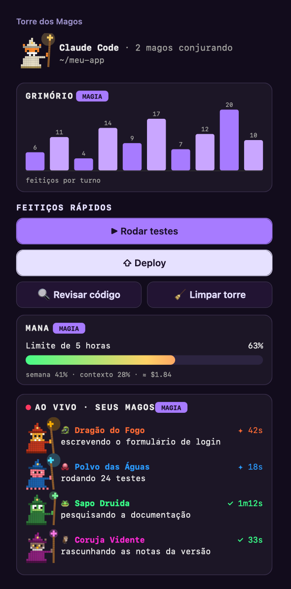
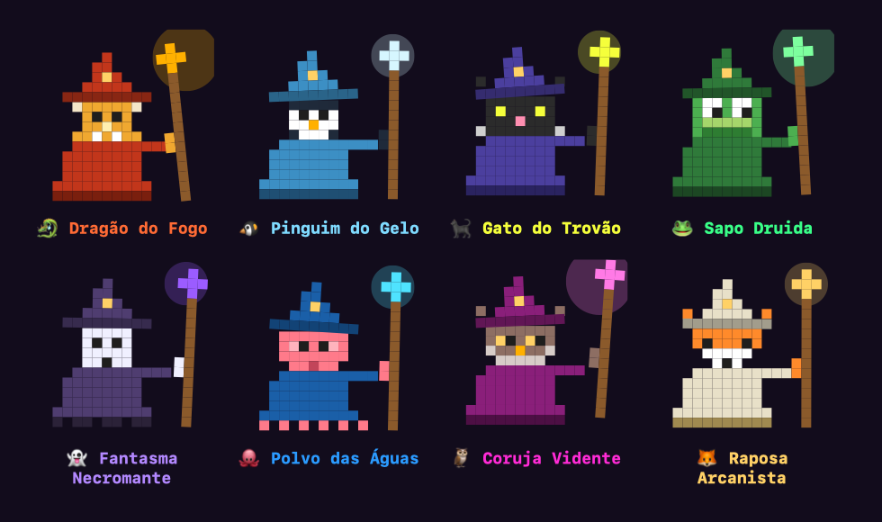
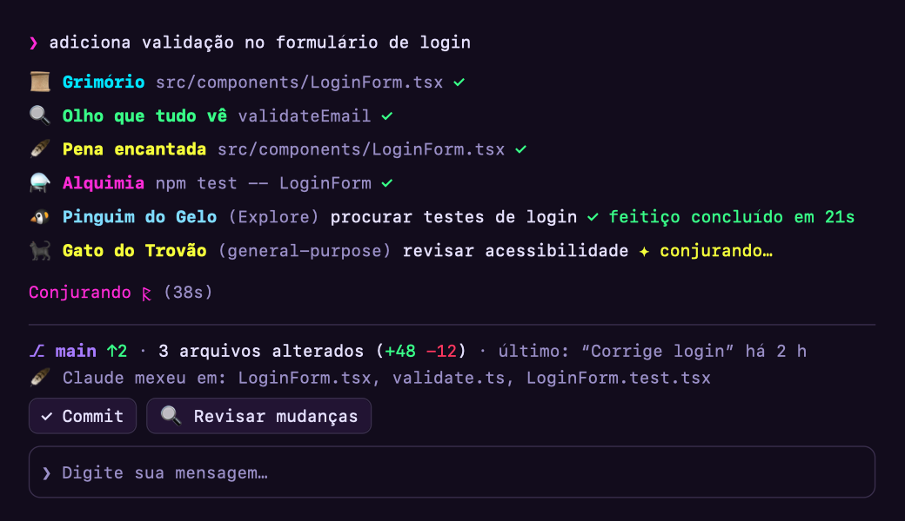

# 🧙 Mods dos Magos

Mods para deixar o Claude Code com tema de magos: subagentes viram criaturas mágicas animadas, as ferramentas viram feitiços e um painel à direita, a **Torre dos Magos**, mostra o que cada mago está fazendo, com botões para rodar testes e fazer deploy.



## O que vem no pacote

### 🏰 Torre dos Magos (painel à direita)
- **Grimório**: gráfico com quantos feitiços (ferramentas) cada turno usou.
- **Feitiços rápidos**: botões **▶ Rodar testes**, **⇧ Deploy**, **🔍 Revisar código** e **🧹 Limpar torre**. Os botões mandam um pedido ao Claude, que age com as permissões de sempre. O deploy pede confirmação antes de publicar.
- **Mana**: uso do limite de 5 horas, da semana, do contexto e o custo.
- **Ao vivo**: cada subagente como uma criatura animada, com a tarefa e o tempo.

Abre sozinha no começo de toda sessão. Para fechar ou abrir de novo, use `/torre`.

### 🐉 Subagentes como criaturas
Cada subagente ganha um mago diferente. Todos são animados: piscam, balançam, mexem o cajado e soltam faíscas, e ficam mais rápidos quando estão conjurando.



### ⚗️ Ferramentas como feitiços, spinner de runas e faixa do projeto
- **Feitiços**:
  - ⚗️ Alquimia: comandos de terminal
  - 📜 Grimório: leitura de arquivos
  - 🪶 Pena encantada: edição e criação de arquivos
  - 🔍 Olho que tudo vê: buscas
  - 🦉 Coruja mensageira: web
- **Spinner de runas** (`ᚠ ᚢ ᚦ ᚨ ᚱ…`) e aviso "🧙 Feitiço concluído" nos turnos longos.
- **Faixa do projeto** acima do prompt: branch, commits para enviar ou puxar, arquivos alterados (+/−), último commit e os arquivos que o Claude mexeu. Tem botões de **Commit**, **Revisar mudanças** e **Atualizar branch**.



> As imagens são geradas a partir do próprio código do mod, com dados de exemplo.

## Instalação

### 1. O mod dos magos

Numa sessão do Claude Code no terminal:

```
/plugin install magos --marketplace DougVec/Mods-dos-magos
```

Responda `y` para adicionar o marketplace e escolha o escopo **user**, para valer em todas as sessões.

O comando `/plugin` só funciona no terminal. Pelo terminal do sistema, sem abrir o Claude, também dá:

```bash
claude plugin marketplace add DougVec/Mods-dos-magos
claude plugin install magos@mods-dos-magos --scope user
```

Um plugin instalado assim no escopo user carrega também no app do Claude (aba Code).

### 2. A skin `mago` (cores e palavras do spinner)

As cores vêm do mod [skins](https://github.com/hellosverre/claude-skins), de hellosverre:

```
/plugin install skins --marketplace hellosverre/claude-skins
```

Depois, numa sessão nova, peça ao Claude:

> Use a ferramenta de skins para salvar a skin descrita em https://github.com/DougVec/Mods-dos-magos/blob/main/skins/mago.json e depois desligue a faixa de medidores (settings band: false).

A faixa de medidores fica desligada porque a mana já aparece na Torre.

### 3. Status line (opcional)

Uma status line com o modelo, o contexto e o limite de 5 horas e da semana, em barras coloridas. Precisa do `jq`.

```bash
curl -fsSL https://raw.githubusercontent.com/DougVec/Mods-dos-magos/main/extras/statusline.sh -o ~/.claude/statusline.sh
chmod +x ~/.claude/statusline.sh
```

E em `~/.claude/settings.json`:

```json
"statusLine": { "type": "command", "command": "~/.claude/statusline.sh" }
```

### 4. Clawd mago (opcional)

O Clawd como mago em ASCII acima do prompt, com o progresso do savvy-flow ao lado. Ele precisa do `savvy-progress`:

```
/plugin install savvy-progress --marketplace JohnnyVizz/claude-kit
/plugin install clawd-mago --marketplace DougVec/Mods-dos-magos
```

## Outros plugins que eu uso

São de outros autores, então ficam só os links:

- [claude-kit](https://github.com/JohnnyVizz/claude-kit): `savvy-flow` e `savvy-progress`
- [oh-my-claudecode](https://github.com/Yeachan-Heo/oh-my-claudecode)
- [superpowers](https://github.com/obra/superpowers-marketplace)
- [claude-mem](https://github.com/thedotmack/claude-mem)

## Personalizar

O mod mora em [`plugins/magos/hooks/register.tsx`](plugins/magos/hooks/register.tsx):

- `MAGOS`: as criaturas, suas cores e o desenho do rosto.
- `FEITICOS`: os nomes e ícones das ferramentas.
- `ACOES`: o texto que cada botão manda ao Claude.

Depois de editar, rode `/reload-plugins`.

## Licença

MIT
